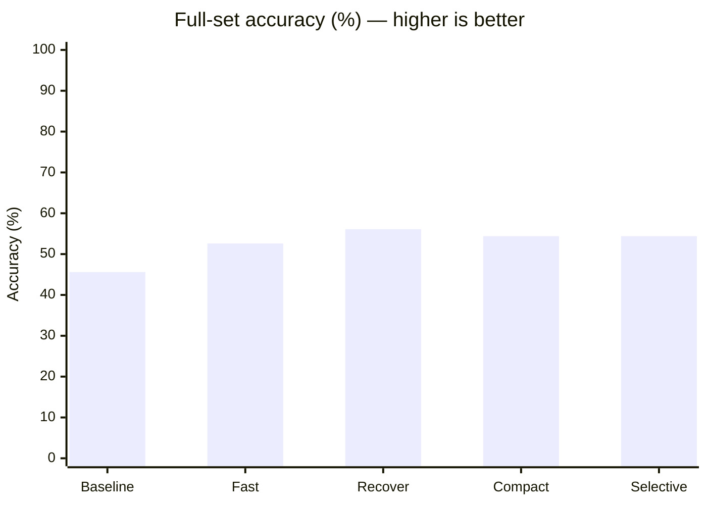
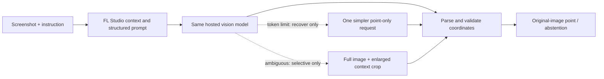
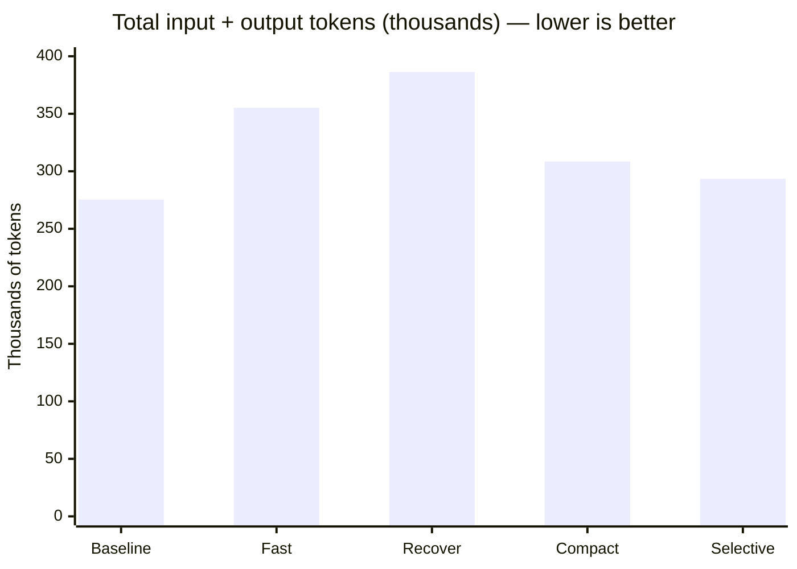

# FLGround: benchmark results and harness design

Measured on 2026-11-02. **Best observed accuracy: 32/57 (56.1%), compared with baseline 26/57 (45.6%) — six additional correct predictions, +10.5 percentage points.** No fine-tuning was used.

**Status:** exploratory full-set experiments, not a clean held-out or matched-budget causal study. We iterated after inspecting this benchmark. Baseline used a 32,768-token output ceiling; candidates below used 8,192.

## Model, task, and benchmark

- **Model:** the user identifies the hosted model as “Qwen 3.8 27B.” Saved manifests record the Fireworks deployment ID, not a verified upstream checkpoint/version. Confirm that mapping before publishing the model name as independently verified. The repository also contains a separate Qwen3.5 adapter evaluation; its results are not the runs summarized here.
- **Deployment:** `accounts/yuxinz721-ofi0hn0kj3/deployments/h0xbbw9t`, shared by these runs. Local Gemma voice-demo inference is separate and is not used for these scores.
- **Benchmark:** [ScreenSpot-Pro](https://huggingface.co/datasets/likaixin/ScreenSpot-Pro), `fruitloops_windows` subset; [official evaluation repository](https://github.com/likaixin2000/ScreenSpot-Pro-GUI-Grounding). Pinned dataset revision: `210e78d3844251110bff86c95835ebd37a6930fa`.
- **Evaluation set:** all 57 examples, comprising 31 icon targets and 26 text targets. The earlier 34-example development run is not mixed into these scores.
- **Input/output:** screenshot plus natural-language instruction → one point in the original screenshot. A correct prediction lies inside the annotated target rectangle, with inclusive box boundaries. Errors and abstentions count as misses.
- **Inference:** temperature 0, top-k 40, zero frequency/presence penalties, 180-second per-call timeout, SDK retries disabled. RGB PNG input; explicit normalized-1000 output mapped to original pixels. Server preprocessing is unverified.
- **Execution:** baseline ran serially; these candidates used up to 20 concurrent examples. Baseline predictions were reused, not rerun. Strategies run separately; they are not a combined ensemble.

## Accuracy results

| Strategy | Correct / 57 | Accuracy | Gain vs baseline | Fixes / regressions | Errors / absent | Calls |
|---|---:|---:|---:|---:|---:|---:|
| Baseline | 26/57 | 45.6% | — | — | 0 / 0 | 57 |
| Panel fast | 30/57 | 52.6% | +7.0 pp | 9 / 5 | 3 / 1 | 57 |
| Panel recover | 32/57 | 56.1% | +10.5 pp | 11 / 5 | 1 / 2 | 62 |
| Panel compact | 31/57 | 54.4% | +8.8 pp | 9 / 4 | 6 / 3 | 57 |
| Panel selective | 31/57 | 54.4% | +8.8 pp | 10 / 5 | 2 / 3 | 58 |



The table contains the exact counts if the Markdown viewer does not render Mermaid charts. One example changes accuracy by approximately 1.75 percentage points. The difference between 31 and 32 correct is only one example; repeat runs are needed to assess stability.

## What the harness does



- **Baseline:** directly asks the model for the target coordinate. It already validates and maps coordinates; validation itself is not a new accuracy feature of the harness.
- **Panel fast:** adds manual-derived FL Studio context and asks the model to identify the panel, exact entity, control, visible evidence, region/anchor, and point. It returns the first validated point without a crop-refinement call.
- **Panel recover:** preserves the fast first call. Only a token-exhausted response gets one simpler point-only retry. Other errors and abstentions do not trigger fallback. Failed calls still count toward latency and token usage.
- **Panel compact:** asks only for visibility, panel, entity, point, and ambiguity. Removes explanatory evidence and bounding boxes to test whether a shorter schema helps.
- **Panel selective:** starts with the compact prompt. If the model reports ambiguity, supplies the full screenshot plus an enlarged 768-pixel context crop for a second localization call. Coordinates still refer to the original full image. The ambiguity flag is not calibrated confidence.

These are alternative strategies, not different models or separate windows. No benchmark labels, target boxes, correctness flags, or saved baseline predictions enter inference. No automatic clicking, navigation, or fine-tuning is part of this evaluation.

## Why it helps — and what the evidence actually shows

Dense FL Studio screens contain repeated controls across the Channel Rack, Mixer, Piano Roll and plugins. Domain context and explicit entity identification aim to reduce wrong-panel and wrong-item choices. This is a design rationale; these experiments do not isolate each prompt component causally.

| Target type | Baseline | Fast | Recover | Compact | Selective |
|---|---:|---:|---:|---:|---:|
| Text (26) | 16 | 22 | 22 | 20 | 20 |
| Icon (31) | 10 | 8 | 10 | 11 | 11 |

The strongest observed gain is on text targets: recovery locates 22/26 versus baseline 16/26. Recovery fixes 11 baseline mistakes but loses 5 previously correct examples. Icon/control semantics remain a limitation; do not describe the harness as universally more accurate.

Recovery triggered five extra calls: four returned valid predictions and one still failed. Valid does not mean correct. Selective verification triggered only once, and that example ended in an error. Consequently this run does **not** establish that crop verification improves accuracy. Differences between compact and selective also include first-pass run variation.

## Token usage and speed

| Strategy | Input tokens | Output tokens incl. reasoning | Total tokens | Mean/example | Full-arm wall time |
|---|---:|---:|---:|---:|---:|
| Baseline | 211,782 | 63,619 | 275,401 | 6.03 s | Not recorded |
| Panel fast | 224,199 | 130,983 | 355,182 | 17.59 s | 75.2 s |
| Panel recover | 242,779 | 143,515 | 386,294 | 16.34 s | 93.5 s |
| Panel compact | 218,670 | 89,800 | 308,470 | 14.41 s | 66.4 s |
| Panel selective | 224,747 | 68,788 | 293,535 | 8.59 s | 61.1 s |



**Accuracy choice:** recover has the highest observed score, 32/57, but uses about 40.3% more total tokens than baseline. **Observed tradeoff:** selective gets 31/57 with 6.6% more total tokens than baseline and 24.0% fewer than recover. It is not cheaper than baseline in token count. Dollar costs are unknown: input/output token prices and deployment billing were not supplied.

Concurrency reduces suite elapsed time, not model work per example. Per-example timings across serial baseline and concurrent candidates are not controlled latency comparisons. All strategies can still exhaust their output budgets; more tokens do not guarantee a correct prediction.

## Reproduce the candidate comparison without rerunning baseline

```bash
uv run python scripts/benchmark.py run \
  --output artifacts/qwen-next-full-8192-repeat \
  --split full \
  --strategies panel_recover panel_compact panel_selective \
  --reuse-baseline artifacts/qwen-before-after/baseline/predictions.jsonl \
  --max-tokens 8192 --concurrency 20 --execute
```

Requires the pinned prepared dataset, the saved baseline artifacts and authorized deployment credentials. Choose a fresh output directory. Maximum 285 new calls; zero baseline inference calls. Omit `--execute` for a dry run. The report flags the output-budget mismatch.

## Evidence and limitations

Source summaries below were read directly; hashes identify the exact files used. Raw screenshots, responses and benchmark artifacts remain excluded from source control. A fresh clone needs those local artifacts to reproduce the reused-baseline comparison; this document alone is not the raw evidence package.

| Local source | SHA-256 |
|---|---|
| `artifacts/qwen-before-after/baseline/summary.json` | `0a099e4dabd6d10ec742884a7179bddb83f699cce5cf40c4ed53259757ce466a` |
| `artifacts/qwen-panel-fast-full-8192/panel_fast/summary.json` | `d09f5c993ab4fb2bf288e2f1bb60f2c42929a6d03c270f196a92fd46b8712c76` |
| `artifacts/qwen-next-full-8192/panel_recover/summary.json` | `d7d39d48e377b33e9e49b9700d1d01458a6963ddd1e80127a4ce3009ca20352a` |
| `artifacts/qwen-next-full-8192/panel_compact/summary.json` | `02634734c20f0fd07c79b15fc1f27b263e0d41d4d2eaed6ffc4db84d3fb5ea51` |
| `artifacts/qwen-next-full-8192/panel_selective/summary.json` | `d5a58d77518fb5d29e45a5c48c6b13073028f2c85722a4000392ed011ae73458` |

The run directories also contain per-example predictions, prompts, call usage, image hashes, manifests and source snapshots. The dataset task-file SHA-256 is `0b46a067581360b985c05c0094adceaf50fc952fd9d8da32cbe8a0d5baa5ce40`.

- Results are selected after iterative development and inspection of this full set; they are exploratory, not untouched held-out estimates.
- Same deployment ID does not independently verify an unchanged upstream checkpoint. Confirm model provenance before external publication.
- Output budgets differ (32,768 baseline versus 8,192 candidate), and concurrency differs. The measured gain is for the complete configuration, not an isolated harness-only causal effect.
- No repeated-run uncertainty analysis or statistical significance claim is provided.
- These scores are not a claim of beating the current public leaderboard, nor proof of live macOS voice/overlay correctness.

## Suggested presentation wording

> On all 57 FL Studio examples in ScreenSpot-Pro, our best observed harness configuration improved grounding accuracy from 45.6% to 56.1% without fine-tuning. It adds FL Studio context, structured target identification, and bounded recovery for token-exhausted responses. A lighter configuration scored 54.4% with only 6.6% more total tokens than baseline. These are exploratory results with differing token budgets.
